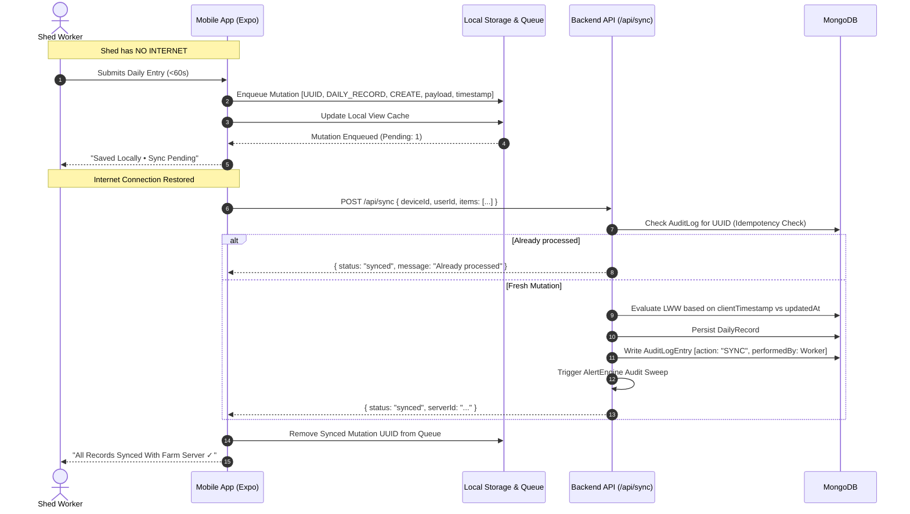

# System Architecture: Broiler Farm Management System

This document outlines the complete system architecture, offline synchronization mechanics, role-based security boundaries, and data flow for the 5-shed broiler farm management system.

---

## 1. Monorepo Structure

```
broiler-farm/
├── apps/
│   ├── api/                    # Node.js + Express + TypeScript Backend
│   │   ├── src/
│   │   │   ├── config/         # Environment & server config
│   │   │   ├── controllers/    # Route controllers (Auth, Sheds, Batches, Feed, Sales, etc.)
│   │   │   ├── middleware/     # Auth (JWT), RBAC, Zod Validator, Error Handler
│   │   │   ├── models/         # Mongoose Schemas (User, Shed, Batch, DailyRecord, etc.)
│   │   │   ├── routes/         # Express REST Routers
│   │   │   ├── services/       # Batch lifecycle, Alert engine, Sync engine, Reporting
│   │   │   ├── utils/          # Seed data generator & helpers
│   │   │   └── __tests__/      # Jest + Supertest + MongoMemoryServer integration tests
│   │   ├── Dockerfile
│   │   └── package.json
│   └── mobile/                 # React Native + Expo (Android, iOS, Admin Web)
│       ├── app/                # Expo Router file-based routing
│       │   ├── (auth)/         # Login screen
│       │   ├── (worker)/       # Worker screens (Today, Daily Entry, Vaccines, Weight, History)
│       │   └── (admin)/        # Admin screens (Dashboard, Sheds, Batches, Feed, Sales, Reports)
│       ├── src/
│       │   ├── api/            # Universal API client with auto-refresh
│       │   ├── components/ui/  # Design system (Button, Card, Input, StatCard, Badge, etc.)
│       │   ├── db/             # OfflineStore & persistent Mutation Sync Queue
│       │   ├── i18n/           # English & Roman Urdu dictionaries
│       │   ├── store/          # Zustand state (Auth, Sync, Theme)
│       │   └── theme/          # Color tokens, spacing, dark mode
│       ├── app.json
│       ├── eas.json
│       └── package.json
├── packages/
│   └── shared/                 # Pure TypeScript domain logic & contracts
│       ├── src/
│       │   ├── constants/      # Target weight standards, vaccination templates
│       │   ├── formulas/       # Pure business formulas (FCR, Mortality %, EPEF, ADG, P&L)
│       │   ├── schemas/        # Zod validation schemas
│       │   └── types/          # Domain TypeScript interfaces
│       └── package.json
└── docs/                       # Architectural & QA documentation
```

---

## 2. High-Level Architecture Diagram

```mermaid
graph TB
    subgraph ClientLayer["Client Layer (Expo Cross-Platform)"]
        MobileWorker["Worker Mobile App<br/>(Android / iOS Phones)"]
        AdminWeb["Admin Laptop Web View<br/>(Responsive Expo Web)"]
        LocalStore["OfflineStore (AsyncStorage / SQLite)<br/>• Local Cache<br/>• Persistent Mutation Queue"]
    end

    subgraph GatewayLayer["API & Security Gateway"]
        APIGateway["Express REST API (Port 5000)<br/>• Helmet Security Headers<br/>• Rate Limiting (1000 req/15min)<br/>• CORS Credentials"]
        AuthMiddleware["JWT Authentication<br/>• Access Token (1h)<br/>• Refresh Token Rotation (7d)"]
        RBACMiddleware["Role-Based Access Control<br/>• Admin: Full CRUD & Financials<br/>• Worker: Assigned Shed Only"]
        ZodValidator["Zod Input Validation"]
    end

    subgraph ServiceLayer["Core Domain Services"]
        BatchService["Batch Lifecycle Service<br/>• Auto-Vaccine Task Seeding<br/>• Final Summary Calculation"]
        AlertEngine["Alerts Engine<br/>• Mortality Spikes<br/>• Feed Low Stock<br/>• Medicine Expiry"]
        SyncService["Sync Service<br/>• Idempotency Check<br/>• Last-Write-Wins (LWW)<br/>• Audit Log Recording"]
        ReportService["Reporting Service<br/>• CSV & PDF Generators<br/>• Feed Reconciliation<br/>• P&L Analysis"]
    end

    subgraph PersistenceLayer["Data Persistence"]
        MongoDB[(MongoDB Database)<br/>• Compound Indexes<br/>• Unique Constraints<br/>• Audit Trail Collection]
    end

    MobileWorker -->|Read / Write| LocalStore
    LocalStore -->|POST /api/sync (Batched Mutations)| APIGateway
    AdminWeb -->|Direct REST Queries| APIGateway

    APIGateway --> AuthMiddleware
    AuthMiddleware --> RBACMiddleware
    RBACMiddleware --> ZodValidator
    ZodValidator --> ServiceLayer

    ServiceLayer --> MongoDB
```

---

## 3. Offline-First Sync & Conflict Resolution Flow

When working in the shed with weak or absent 3G/EDGE internet connectivity:
1. All worker actions (daily entries, vaccination completions, sample weights) write immediately to the local cache and are enqueued into a persistent `SyncQueue` with a client UUID mutation ID.
2. The UI provides instant tactile feedback, displaying a non-blocking banner: `"X changes pending - Will sync when connected"`.
3. When network connectivity is re-established, the sync engine dispatches `POST /api/sync` with the mutation packet.
4. The server executes an **Idempotent Last-Write-Wins (LWW)** algorithm and records every action to the immutable `AuditLog`.



---

## 4. Role-Based Access Control (RBAC) Matrix

| Resource / Endpoint | Admin Role | Worker Role | Boundary Enforcement Mechanism |
| :--- | :--- | :--- | :--- |
| **Login / Refresh Token** | Allowed | Allowed | `authenticate` |
| **All 5 Sheds Overview** | Allowed | View Assigned Shed Only | `requireShedAccess` |
| **Batch Details** | All Batches | Assigned Shed's Batch Only | Backend route guard + Query filter |
| **Place New Batch (Chicks)** | Allowed | 403 Forbidden | `requireAdmin` |
| **Close Batch (Harvest P&L)** | Allowed | 403 Forbidden | `requireAdmin` |
| **Create Daily Record** | Allowed | Assigned Shed Only (Today only) | `requireShedAccess` + Date Lock Policy |
| **Edit Daily Record** | Allowed | Same day only (unless unlocked) | `DailyRecord.isLocked` Check |
| **Unlock Daily Record** | Allowed | 403 Forbidden | `requireAdmin` + Audit Log |
| **Vaccination Tasks** | Full CRUD | Complete tasks for assigned shed | `requireShedAccess` |
| **Feed Purchases** | Full CRUD | 403 Forbidden | `requireAdmin` |
| **Feed Issue to Shed** | Full CRUD | 403 Forbidden | `requireAdmin` |
| **Expenses (All Categories)**| Full CRUD | 403 Forbidden | `requireAdmin` |
| **Sales & Buyer Invoices** | Full CRUD | 403 Forbidden | `requireAdmin` |
| **Staff & Payroll Wages** | Full CRUD | 403 Forbidden | `requireAdmin` |
| **Financial Reports & P&L** | Full CRUD | 403 Forbidden | `requireAdmin` |
| **Admin Dashboard** | Full Access | 403 Forbidden | `requireAdmin` |
| **User Management** | Full CRUD | 403 Forbidden | `requireAdmin` |
| **Farm Thresholds** | Full CRUD | 403 Forbidden | `requireAdmin` |

---

## 5. Pure Business Formulas

All mathematical and financial formulas are isolated as pure, test-covered functions in `@broiler/shared/src/formulas`:
- **Mortality %**:
  $$\text{Mortality \%} = \frac{\text{Placed} - \text{Birds Remaining}}{\text{Placed}} \times 100$$
- **Birds Remaining**:
  $$\text{Remaining} = \text{Placed} - \text{Cumulative Mortality} - \text{Culls} - \text{Birds Sold}$$
- **Feed Conversion Ratio (FCR)**:
  $$\text{FCR} = \frac{\text{Total Feed Consumed (kg)}}{\text{Total Live Weight (kg)}}$$
- **Cost per kg**:
  $$\text{Cost per kg} = \frac{\text{Total Batch Cost (PKR)}}{\text{Total Live Weight Sold (kg)}}$$
- **Net Profit**:
  $$\text{Net Profit} = \text{Total Sales Revenue} - \text{Total Batch Cost}$$
- **European Production Efficiency Factor (EPEF)**:
  $$\text{EPEF} = \frac{\text{Livability \%} \times \text{Average Live Weight (kg)}}{\text{Age in Days} \times \text{FCR}} \times 100$$
- **Average Daily Gain (ADG)**:
  $$\text{ADG (g/day)} = \frac{\text{Current Sample Weight (g)} - \text{Day 0 Weight (42g)}}{\text{Age in Days}}$$
