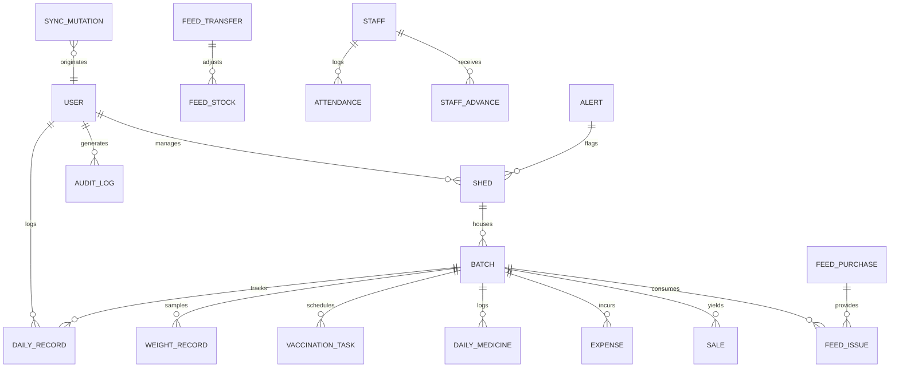

# Broiler Farm Management System - Data Model & Schema Architecture

## 1. Overview

The Broiler Farm Management System utilizes a schema-enforced document store (MongoDB with Mongoose) coupled with strict TypeScript interfaces (`@broiler/shared`) and local offline persistent SQLite tables (`expo-sqlite`). Every business transaction records immutable audit trails, actor identification, and client timestamps to enable robust Last-Write-Wins (LWW) multi-master sync reconciliation and day/night shift merging.

---

## 2. Entity Relationship Diagram (ERD)

---

## 3. Core Collections & Schema Specifications

### 3.1 Users (`users`)

- `_id`: `ObjectId`
- `username`: `String` (unique, lowercase, indexed)
- `passwordHash`: `String` (bcrypt salted hash, 10 rounds)
- `name`: `String`
- `phone`: `String` (Pakistani format: `03XXXXXXXXX`)
- `role`: `'admin' | 'worker'` (indexed)
- `assignedShedId`: `ObjectId` (ref: `Shed`, nullable for admin)
- `isActive`: `Boolean` (default: `true`)
- `mustChangePassword`: `Boolean` (default: `true` for all seeded and admin-created users)
- `timestamps`: `createdAt`, `updatedAt`

### 3.2 Sheds (`sheds`)

- `_id`: `ObjectId`
- `name`: `String` (e.g., "Shed 1 - North Wing")
- `shedNumber`: `Number` (1 to 5, unique, indexed)
- `capacity`: `Number` (e.g., 5,000 birds)
- `status`: `'empty' | 'active' | 'cleaning'` (indexed)
- `currentBatchId`: `ObjectId` (ref: `Batch`, nullable)
- `assignedWorkerId`: `ObjectId` (ref: `User`)

### 3.3 Daily Records (`dailyrecords`) - Mirroring 16-Column Paper Register

- `_id`: `ObjectId`
- `batchId`: `ObjectId` (ref: `Batch`, indexed)
- `shedId`: `ObjectId` (ref: `Shed`, indexed)
- `date`: `String` (`YYYY-MM-DD`, indexed)
- `dayNumber`: `Number` (1–45)
- `shift`: `'day' | 'night' | 'full'`
- **Shift Feed Fields**:
  - `openingFeedStockBags`: `Number`
  - `feedUsedDayShiftBags`: `Number` (DAY shift bags)
  - `feedUsedNightShiftBags`: `Number` (NIGHT shift bags)
  - `feedUsedBags`: `Number` (24h Total = DAY + NIGHT)
  - `feedUsedKg`: `Number` (Calculated kg)
  - `feedReceivedBags`: `Number` (Added feed)
  - `feedTransferredOutBags`: `Number` (Transferred to other farm/shed)
  - `closingFeedStockBags`: `Number` (Physical or expected closing stock)
  - `feedRemarks`: `String` (e.g., "Star Feed borrowed from Shed 2")
- **Shift Mortality Fields**:
  - `openingBirds`: `Number`
  - `mortalityDayShift`: `Number` (DAY shift bird loss)
  - `mortalityDayCause`: `String` (Reason: heat, weakness, etc.)
  - `mortalityNightShift`: `Number` (NIGHT shift bird loss)
  - `mortalityNightCause`: `String`
  - `mortalityCount`: `Number` (24h Total = DAY + NIGHT)
  - `culls`: `Number` (Weak/culled birds)
  - `closingBirds`: `Number` (Calculated remaining)
- **Paper Register Custom Column**:
  - `customColumnES`: `Number | null` (Admin-configurable column, excluded from automated formulas until assigned)
- **Environment**:
  - `waterLiters`: `Number`
  - `minTemp`: `Number` (°C)
  - `maxTemp`: `Number` (°C)
  - `litterCondition`: `'dry' | 'normal' | 'wet'`
  - `notes`: `String`
- `isLocked`: `Boolean` (Locked after shift/day, editable via admin unlock)

### 3.4 Feed Transfers & Lending (`feedtransfers`)

- `_id`: `ObjectId`
- `date`: `String` (`YYYY-MM-DD`)
- `partyName`: `String` (Farm owner or feed dealer, e.g. "Star Feed", "Haji Aslam Farm")
- `transferType`: `'received' | 'given'` (borrowed vs lent)
- `feedBrand`: `String` (e.g. Star Feed, Chenab Feed)
- `feedType`: `'starter' | 'grower' | 'finisher'`
- `bagCount`: `Number` (Quantity in bags)
- `notes`: `String`

### 3.5 Catching & Partial Lifting Lots (`sales`)

- `_id`: `ObjectId`
- `batchId`: `ObjectId` (ref: `Batch`, indexed)
- `shedId`: `ObjectId` (ref: `Shed`, indexed)
- `lotNumber`: `Number` (1, 2, 3...)
- `date`: `String` (`YYYY-MM-DD`)
- `buyerName`: `String`
- `buyerPhone`: `String`
- `totalLiveWeightKg`: `Number` (Weighbridge gross live kg)
- `averageWeightKg`: `Number` (Average kg per bird)
- `birdsSold`: `Number` (Auto-computed = `round(totalLiveWeightKg / averageWeightKg)`)
- `isManualBirdCountOverride`: `Boolean`
- `overrideReason`: `String` (Mandatory when overridden)
- `ratePerKg`: `Number` (PKR per kg, manually editable)
- `totalAmount`: `Number` (`totalLiveWeightKg * ratePerKg`)
- `amountPaid`: `Number`
- `balanceDue`: `Number`
- `paymentStatus`: `'paid' | 'partial' | 'pending'`
- `vehicleNo`: `String`

### 3.6 Daily Medicine Sheet (`dailymedicines`)

- `_id`: `ObjectId`
- `batchId`: `ObjectId` (ref: `Batch`)
- `shedId`: `ObjectId` (ref: `Shed`)
- `date`: `String` (`YYYY-MM-DD`)
- `items`: `Array` of:
  - `name`: `String` (e.g., Vitamin AD3E, Electrolyte Power, Acidifier)
  - `category`: `'vitamins' | 'electrolytes' | 'antibiotics' | 'respiratory' | 'acidifier' | 'vaccine' | 'other'`
  - `quantity`: `String` (optional)
  - `unit`: `String` (optional, ml/grams)
  - `cost`: `Number` (optional)
- Distinct names cached for autocomplete chip suggestions.

### 3.7 Farm Settings (`farmsettings`)

- `_id`: `ObjectId`
- `farmName`: `String`
- `ownerName`: `String`
- `location`: `String`
- `phone`: `String`
- `defaultFeedBagWeightKg`: `Number` (default: 50.0)
- `customDailyColumnLabel`: `String` (default: "E.S")
- `customDailyColumnEnabled`: `Boolean` (default: true)
- `batchScope`: `'multi_shed' | 'per_shed'` (default: "multi_shed")
- `alertThresholds`:
  - `mortalitySpikePercentDaily`: `Number` (default: 1.0%)
  - `mortalityWeeklyPercent`: `Number` (default: 3.5%)
  - `lowFeedStockBags`: `Number` (default: 20)
  - `tempMinCelsius`: `Number`
  - `tempMaxCelsius`: `Number`
