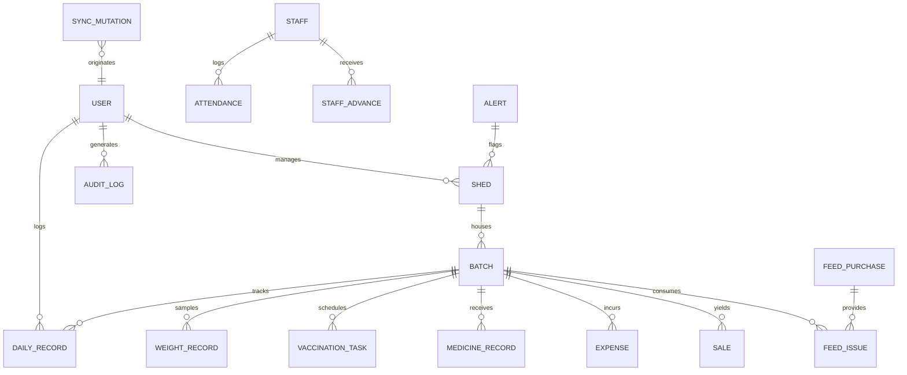

# Broiler Farm Management System - Data Model & Schema Architecture

## 1. Overview

The Broiler Farm Management System utilizes a schema-enforced document store (MongoDB with Mongoose) coupled with strict TypeScript interfaces (`@broiler/shared`) and local offline persistent caches (SQLite / AsyncStorage). Every business transaction records immutable audit trails, actor identification, and client timestamps to enable robust Last-Write-Wins (LWW) multi-master sync reconciliation.

---

## 2. Entity Relationship Diagram (ERD)

---

## 3. Core Collections & Schema Specifications

### 3.1 Users (`users`)

Stores authentication credentials, contact details, assigned sheds, and RBAC roles.

- `_id`: `ObjectId`
- `username`: `String` (unique, lowercase, indexed)
- `passwordHash`: `String` (bcrypt salted hash, 10 rounds)
- `name`: `String`
- `phone`: `String` (Pakistani format: `03XXXXXXXXX`)
- `role`: `'admin' | 'worker'` (indexed)
- `assignedShedId`: `ObjectId` (ref: `Shed`, nullable for admin)
- `isActive`: `Boolean` (default: `true`)
- `refreshTokenHash`: `String` (optional, for token rotation)
- `timestamps`: `createdAt`, `updatedAt`

### 3.2 Sheds (`sheds`)

Physical broiler houses on the poultry facility.

- `_id`: `ObjectId`
- `name`: `String` (e.g., "Shed 1 - Alpha")
- `shedNumber`: `Number` (1 to 5, unique, indexed)
- `capacity`: `Number` (e.g., 5,000 birds)
- `status`: `'empty' | 'active' | 'cleaning'` (indexed)
- `assignedWorkerId`: `ObjectId` (ref: `User`, optional)
- `currentBatchId`: `ObjectId` (ref: `Batch`, optional)
- `timestamps`: `createdAt`, `updatedAt`

### 3.3 Batches / Flocks (`batches`)

A placed flock of broiler chicks from placement to harvest.

- `_id`: `ObjectId`
- `batchNumber`: `String` (e.g., "FLOCK-2026-S1", unique, indexed)
- `shedId`: `ObjectId` (ref: `Shed`, indexed)
- `chicksPlaced`: `Number` (e.g., 5,000)
- `placementDate`: `String` (YYYY-MM-DD, indexed)
- `expectedCloseDate`: `String` (YYYY-MM-DD)
- `actualCloseDate`: `String` (YYYY-MM-DD, optional)
- `supplier`: `String` (e.g., "Big Bird Hatcheries")
- `breed`: `String` (e.g., "Cobb 500", "Ross 308")
- `chickRate`: `Number` (PKR per chick)
- `initialCost`: `Number` (chicksPlaced * chickRate)
- `status`: `'active' | 'closed'` (indexed)
- `summary`: `BatchCloseSummary` embedded object (computed on batch close):
  - `totalMortality`, `mortalityPercent`, `totalCulls`
  - `totalBirdsSold`, `totalLiveWeightSoldKg`, `averageWeightSoldKg`
  - `totalFeedConsumedKg`, `fcr`, `costPerKg`, `totalExpenses`
  - `totalRevenue`, `netProfit`, `epef`, `livabilityPercent`
- `closedBy`: `ObjectId` (ref: `User`)
- `closedAt`: `Date`
- `timestamps`: `createdAt`, `updatedAt`

### 3.4 Daily Records (`daily_records`)

Submitted once daily per shed by the assigned worker.

- `_id`: `ObjectId`
- `batchId`: `ObjectId` (ref: `Batch`, indexed)
- `shedId`: `ObjectId` (ref: `Shed`, indexed)
- `date`: `String` (YYYY-MM-DD, compound index `[batchId, date]` unique)
- `ageInDays`: `Number` (0 to 45)
- `mortalityCount`: `Number` (default 0)
- `mortalityCause`: `String` (optional)
- `culls`: `Number` (default 0)
- `feedUsedBags`: `Number` (e.g., 8 bags)
- `feedUsedKg`: `Number` (bags * bagWeightKg)
- `feedType`: `'starter' | 'grower' | 'finisher'`
- `waterIntakeLiters`: `Number` (optional)
- `tempMinC`: `Number` (optional)
- `tempMaxC`: `Number` (optional)
- `litterCondition`: `'good' | 'fair' | 'poor' | 'wet'`
- `notes`: `String` (optional)
- `photoUrl`: `String` (optional)
- `isLocked`: `Boolean` (locked past midnight unless unlocked by Admin)
- `createdBy`: `ObjectId` (ref: `User`)
- `updatedBy`: `ObjectId` (ref: `User`)
- `clientUpdatedAt`: `String` (ISO 8601 for LWW offline reconciliation)
- `timestamps`: `createdAt`, `updatedAt`

### 3.5 Weight Records (`weight_records`)

Weekly random sample weighings to track against standard Cobb 500 growth curves.

- `_id`: `ObjectId`
- `batchId`: `ObjectId` (ref: `Batch`, indexed)
- `shedId`: `ObjectId` (ref: `Shed`, indexed)
- `week`: `Number` (Week 1 through 6)
- `ageInDays`: `Number`
- `sampleSize`: `Number` (e.g., 50 or 100 birds)
- `totalSampleWeightKg`: `Number`
- `averageWeightGrams`: `Number`
- `targetWeightGrams`: `Number` (standard standard for age)
- `uniformityPercent`: `Number` (optional)
- `date`: `String` (YYYY-MM-DD)
- `notes`: `String`
- `createdBy`: `ObjectId`
- `timestamps`: `createdAt`, `updatedAt`

### 3.6 Vaccination Templates & Tasks (`vaccination_templates`, `vaccination_tasks`)

Admin-configurable schedules auto-instantiated for every newly created batch.

- **Template**:
  - `name`: `String`
  - `isDefault`: `Boolean`
  - `schedule`: Array of `{ ageInDays, vaccineName, route, notes, isMandatory }`
- **Task**:
  - `batchId`: `ObjectId` (ref: `Batch`, indexed)
  - `shedId`: `ObjectId` (ref: `Shed`, indexed)
  - `ageInDays`: `Number`
  - `dueDate`: `String` (YYYY-MM-DD, indexed)
  - `vaccineName`: `String` (ND, IB, IBD/Gumboro, Hydro/HPS)
  - `route`: `'drinking_water' | 'eye_drop' | 'spray' | 'injection_sc' | 'injection_im'`
  - `status`: `'pending' | 'completed' | 'skipped'` (indexed)
  - `completedAt`: `Date`
  - `completedBy`: `ObjectId` (ref: `User`)
  - `completedByName`: `String`
  - `notes`: `String`

### 3.7 Feed Management (`feed_purchases`, `feed_issues`)

- **Feed Purchase**:
  - `purchaseDate`: `String` (YYYY-MM-DD)
  - `supplier`: `String` (e.g., "Supreme Feeds")
  - `feedType`: `'starter' | 'grower' | 'finisher'`
  - `bags`: `Number`
  - `bagWeightKg`: `Number` (default 50.0 kg)
  - `totalKg`: `Number`
  - `ratePerBag`: `Number` (PKR)
  - `totalAmount`: `Number`
  - `invoiceNumber`: `String`
- **Feed Issue**:
  - `date`: `String`
  - `batchId`: `ObjectId`
  - `shedId`: `ObjectId`
  - `feedType`: `String`
  - `bags`: `Number`
  - `bagWeightKg`: `Number`
  - `totalKg`: `Number`
  - `issuedToStaffId`: `ObjectId`

### 3.8 Expenses (`expenses`)

Granular financial outlays categorized for P&L tracking.

- `date`: `String` (YYYY-MM-DD, indexed)
- `category`: `'chicks' | 'feed' | 'medicine' | 'electricity' | 'labour' | 'fuel_generator' | 'transport' | 'maintenance' | 'miscellaneous'`
- `amount`: `Number` (PKR, indexed)
- `batchId`: `ObjectId` (optional, null for farm-level general overhead)
- `shedId`: `ObjectId` (optional)
- `description`: `String`
- `paidTo`: `String`
- `paymentMethod`: `'cash' | 'bank_transfer' | 'check'`
- `receiptNumber`: `String`

### 3.9 Sales & Buyer Ledgers (`sales`, `buyer_payments`)

Flock harvest bird sales with manually editable rates and running balances.

- `date`: `String` (YYYY-MM-DD, indexed)
- `batchId`: `ObjectId` (ref: `Batch`, indexed)
- `shedId`: `ObjectId` (ref: `Shed`, indexed)
- `buyerName`: `String` (indexed)
- `buyerPhone`: `String`
- `birdsSold`: `Number`
- `totalLiveWeightKg`: `Number`
- `averageWeightKg`: `Number` (totalLiveWeightKg / birdsSold)
- `ratePerKg`: `Number` (editable PKR rate)
- `totalAmount`: `Number` (totalLiveWeightKg * ratePerKg)
- `amountPaid`: `Number`
- `remainingBalance`: `Number`
- `paymentStatus`: `'paid' | 'partial' | 'pending'`
- `payments`: Array of `{ date, amount, paymentMethod, notes }`

### 3.10 Staff & Payroll (`staff`, `attendance`, `staff_advances`)

- **Staff**: `name`, `role`, `phone`, `dailyWage`, `assignedShedId`, `isActive`
- **Attendance**: `staffId`, `date` (unique per staff/day), `status` ('present' | 'absent' | 'half_day' | 'leave'), `notes`
- **Advances**: `staffId`, `date`, `amount`, `reason`, `deducted`

### 3.11 System Alerts (`alerts`)

Real-time automated warnings generated by the alerting engine.

- `type`: `'mortality_spike' | 'missed_daily_entry' | 'vaccine_due' | 'vaccine_overdue' | 'low_feed_stock' | 'medicine_expiry' | 'abnormal_temperature' | 'pending_payment'`
- `severity`: `'info' | 'warning' | 'critical'`
- `title`: `String`
- `message`: `String`
- `shedId`: `ObjectId` (optional)
- `batchId`: `ObjectId` (optional)
- `isResolved`: `Boolean` (indexed)
- `resolvedAt`: `Date`
- `resolvedBy`: `ObjectId`

### 3.12 Audit Logs (`audit_logs`)

Tamper-evident logs of all mutations, record edits, and deletions.

- `userId`: `ObjectId`
- `userName`: `String`
- `action`: `'create' | 'update' | 'delete' | 'sync' | 'unlock'`
- `entity`: `String` (e.g., 'daily_record', 'sale', 'expense')
- `entityId`: `String`
- `oldValue`: `Object`
- `newValue`: `Object`
- `ipAddress`: `String`
- `userAgent`: `String`
- `timestamp`: `Date` (indexed)

### 3.13 Sync Queue Log (`sync_mutations`)

Idempotency registry tracking client-generated mutation IDs.

- `clientMutationId`: `String` (UUID v4, unique, indexed)
- `userId`: `ObjectId`
- `entityType`: `String`
- `action`: `String`
- `status`: `'applied' | 'rejected' | 'conflict_resolved'`
- `serverProcessedAt`: `Date`

---

## 4. Database Indexing Strategy

Compound and specialized indexes for sub-10ms query performance:

1. `daily_records`: `{ batchId: 1, date: -1 }` (unique constraint on batchId + date)
2. `daily_records`: `{ shedId: 1, date: -1 }`
3. `vaccination_tasks`: `{ batchId: 1, status: 1, dueDate: 1 }`
4. `sales`: `{ batchId: 1, date: 1 }`
5. `expenses`: `{ batchId: 1, category: 1 }`
6. `attendance`: `{ staffId: 1, date: -1 }` (unique constraint on staffId + date)
7. `sync_mutations`: `{ clientMutationId: 1 }` (unique)
8. `alerts`: `{ isResolved: 1, severity: 1, createdAt: -1 }`
